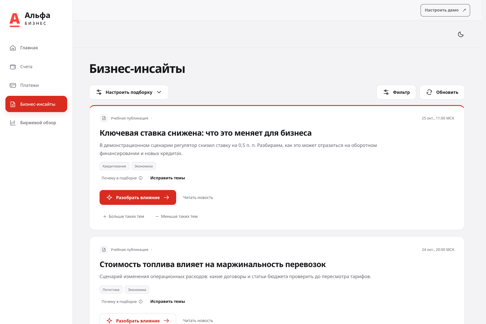
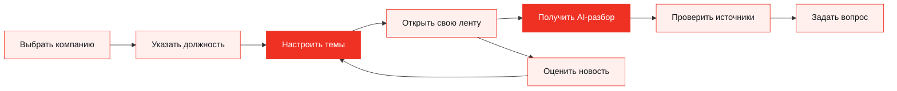
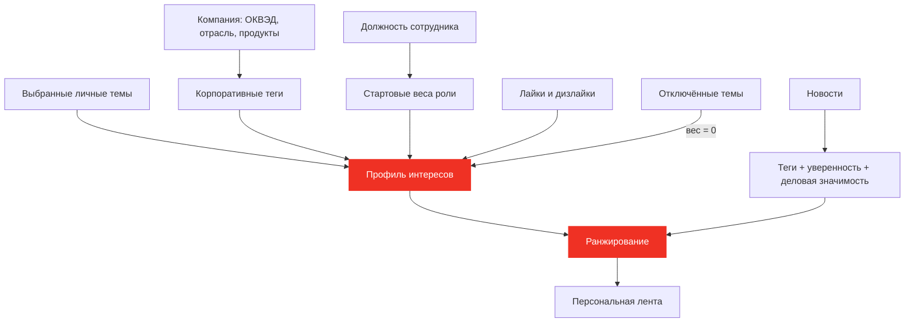
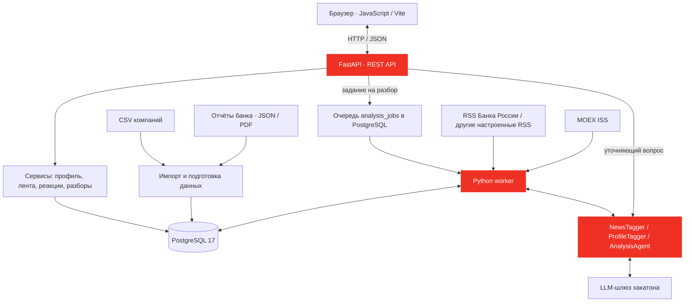
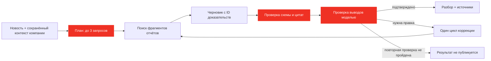
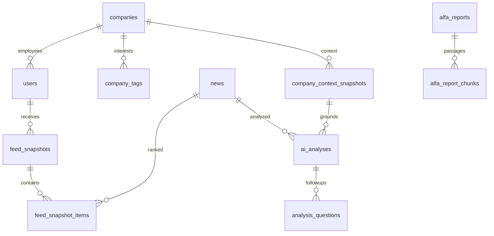

# Бизнес-инсайты · Alpha Hack News Analytics

**Новости → интересы компании и сотрудника → разбор с источниками → решение.**

Командный проект для хакатона Альфа-Банка. Мы сделали персональную новостную ленту для бизнеса: сервис учитывает отрасль компании, должность и выбранные темы, объясняет значимость события и находит подтверждения в банковской аналитике.

[Презентация PowerPoint](Alpha_Hack_News_Analytics.pptx) · [Установка и тестирование](setup.md) · [API](#api) · [Стек](#стек-и-структура-проекта)

| Интерфейс | Backend | Данные | AI |
|---|---|---|---|
| JavaScript · Vite 8 · CSS | Python 3.12 · FastAPI | PostgreSQL 17 · SQLAlchemy | Qwen · GLM · RAG |



## Что получает пользователь

| Возможность | Как это работает |
|---|---|
| **Своя подборка** | Компания + должность + личные интересы + реакции |
| **Управляемые теги** | Темы можно выбирать и отключать; корпоративные веса настраиваются в backend |
| **AI-разбор** | Факты, значимость для компании, риски, возможности и рекомендации |
| **Проверяемые выводы** | Ссылка на новость, фрагмент отчёта, страница и исходная цитата |
| **Уточняющие вопросы** | Ответ по сохранённому разбору и контексту той же компании |
| **Обратная связь** | Лайки и дизлайки меняют интересы; ошибка тегирования отмечается отдельно |
| **Биржевой обзор** | Котировки MOEX, поиск инструментов и время обновления |



## Две стороны интересов — один язык тегов

**Интересы бизнеса и интересы сотрудника представлены тегами из общего справочника. Такими же тегами размечаются новости.** География учитывается отдельно.



| Уровень | Пример | Где менять |
|---|---|---|
| Компания | Логистика, кредитование, инвестиции | Отключение для своей ленты — в интерфейсе; общий набор и веса `0…2` — через `ProfileService.set_company_tags()` |
| Должность | У бухгалтера — налоги и НДС; у казначея — валюты и ставки | Выбор должности в интерфейсе; политика ролей в backend |
| Сотрудник | Добавить технологии, убрать неинтересную тему | Темы над лентой → `PUT /api/profile/interests` |
| Реакции | «Полезно» / «Неинтересно» | Кнопки в карточке новости |

Автоматическая разметка компании сохраняет ручные корпоративные теги. Смена компании сохраняет личные интересы. Отключённая тема получает нулевой вес даже при совпадении с ролью или бизнесом.

**Пример:** перевозчику важны логистика и кредитование; финансовому директору — ставки и бюджет. Сотрудник добавляет валютные расчёты, отключает кадры и получает подборку под свою задачу.

Код: [профиль и веса](backend/app/services/profiles.py) · [роли](backend/app/services/profile_policy.py) · [темы компании](backend/app/services/company_topics.py) · [справочник](backend/app/tags.json).

## Архитектура



| Компонент | Ответственность |
|---|---|
| **Frontend** | Выбор компании и роли, лента, темы, AI-панель, источники, рынок; светлая и тёмная темы |
| **API** | Сессии, проверка входных данных и доступа, выдача ленты, постановка задач |
| **Service Layer** | Правила профиля, ранжирование, обратная связь, кеширование разборов |
| **Worker** | RSS, котировки, разметка новостей и компаний, выполнение AI-задач |
| **PostgreSQL** | Данные, очередь, снимки ленты, полнотекстовый поиск, состояние воркера |
| **AI-агенты** | Структурированная разметка, поиск подтверждений и проверка выводов |

Слои backend: **API → Services → Unit of Work → Repositories → SQLAlchemy → PostgreSQL**. Очередь хранится в БД; отдельный брокер сообщений для текущей реализации не нужен.

## Как строится лента

| Шаг | Правило |
|---|---|
| 1. Профиль | Берём максимальный базовый вес темы из компании, роли и личного выбора |
| 2. Обратная связь | Корректируем вес реакциями, ограничиваем диапазоном `0…2` |
| 3. Отбор | Нужны совпавшие темы и деловая значимость новости `≥ 0,3` |
| 4. Локальные события | Требуют связи с темами компании или явным личным выбором |
| 5. Порядок | Учитываем совпадение, деловую значимость, свежесть и географию |
| 6. Снимок | Сохраняем порядок и версию профиля для пагинации и реакций |

```text
Сигнал темы = min(1, вес профиля × уверенность тега × качество тега / 2)
Совпадение  = max(сигнал × 1,0 для темы компании/пользователя; иначе × 0,7)
Свежесть    = 1 / (1 + возраст новости в днях / 3)
База        = совпадение × деловая значимость × (0,85 + 0,15 × свежесть) × геофактор
Итог        = база + 0,1 × геосовпадение × база × (1 − база)
```

Неизвестная география не создаёт бонус. Регион регистрации учитывается слабее подтверждённого региона деятельности. Свежесть влияет на порядок уже подходящих новостей. Текущий алгоритм — явная формула: [ranking.py](backend/app/services/ranking.py).

## Как работает AI-разбор



**RAG:** агент ищет в загруженной аналитике банка через полнотекстовый поиск PostgreSQL на русском языке (`websearch_to_tsquery`, `ts_rank_cd`). Векторная БД для этого сценария не используется.

| В разборе | На что опирается |
|---|---|
| Что произошло | Факты исходной новости |
| Почему важно компании | Конкретные признаки сохранённого профиля |
| Риски и возможности | Источник + условие, при котором возможен эффект |
| Что проверить / сделать | Подтверждённый контекст события |
| Позиция банка | Только найденный фрагмент банковского отчёта |

Модель выбирает ID отрывков, а сервер подставляет исходные цитаты и проверяет их принадлежность источнику. При нехватке данных разбор содержит ограничения. Кеш учитывает новость, контекст компании и версии модели, промпта и корпуса отчётов. Уточнения используют сохранённый контекст исходного разбора.

Код: [AnalysisAgent](backend/app/services/ai_agents/analysis.py) · [схемы ответа](backend/app/schemas/agent.py) · [очередь и кеш](backend/app/services/insights.py).

## Защита AI-агента от вредоносных инструкций и кода

| Рубеж | Реализация |
|---|---|
| **Отделение данных от команд** | Новости, документы и примеры ошибок передаются как данные; системные инструкции запрещают выполнять команды из них |
| **Ограниченные действия** | Оркестратор сам выполняет поиск; модели не предоставлены shell, выполнение Python или произвольные файловые инструменты |
| **Строгий контракт** | Ответ — JSON по Pydantic-схеме; лишние поля, неизвестные теги и недопустимые значения отклоняются |
| **Проверка доказательств** | ID источников, цитаты и признаки компании сверяются сервером; неподтверждённый разбор не выдаётся готовым |
| **Защита отображения** | Динамический текст экранируется перед вставкой в интерфейс |
| **Контроль вызовов** | Разрешённые ID моделей, HTTPS, запрет редиректов с ключом, таймауты, ограничения ответа, суточный лимит и проверка бюджета |

Это конкретные меры против prompt injection и исполнения входного кода, а не обещание абсолютной невзламываемости. Демовход имитирует банковскую авторизацию.

Код: [ограничения разметчиков](backend/app/services/ai_agents/_common.py) · [JSON-клиент](backend/app/services/ai_agents/client.py) · [валидация разбора](backend/app/services/ai_agents/analysis.py).

## Данные и фоновые процессы



Схема показывает основные связи. Очередь `analysis_jobs`, реакции, события показов и открытий, `llm_usage`, `processing_states` и биржевые данные хранятся рядом в PostgreSQL.

| Цикл worker по умолчанию | Период / порция |
|---|---|
| RSS Банка России | 15 минут / до 30 записей |
| Котировки MOEX | 15 минут |
| Разметка новостей | 5 минут / 1 новость |
| Разметка изменённых компаний | 2 минуты / 1 компания |
| Проверка очереди AI-разборов | 5 секунд |
| Импорт подготовленных отчётов | При старте |

Источники и интервалы задаются JSON-конфигурацией: [WorkerSettings](backend/app/schemas/worker.py). В репозитории есть **104 подготовленные реальные публикации** для демонстрации; происхождение разметки указано в каждой записи. CSV компаний и материалы банка передаются командой отдельно.

## Стек и структура проекта

| Слой | Технологии |
|---|---|
| Web | Vanilla JavaScript, HTML, CSS, Vite 8; Node.js 22.12+ |
| HTTP API | FastAPI, Uvicorn, Pydantic, pydantic-settings |
| Хранение | PostgreSQL 17, SQLAlchemy 2, psycopg 3, JSONB, полнотекстовый поиск |
| Сбор данных | httpx, feedparser, Beautiful Soup, trafilatura, pandas |
| AI | Qwen3.6 35B A3B для новостей; GLM-5.3-Flash для профилей и анализа |
| Документы | Подготовленные JSON; отдельный PDF/OCR-парсер на PyMuPDF и Tesseract |
| Проверки | pytest, unittest, FastAPI TestClient, Node.js test runner |
| Окружение | Docker Compose для БД и импорта, конфигурации PyCharm, GitHub Actions для фронтенда |

```text
.
├── readme.md                       # Обзор и схемы
├── setup.md                        # Установка, запуск, тесты
├── requirements.txt                # Подключает зависимости backend
├── Alpha_Hack_News_Analytics.pptx   # Презентация проекта
├── backend/
│   ├── app/
│   │   ├── api/                    # REST-маршруты
│   │   ├── services/ai_agents/     # Разметчики и RAG-агент
│   │   ├── services/               # Правила приложения
│   │   ├── schemas/                # Контракты данных
│   │   ├── infrastructure/database/# Модели, репозитории, транзакции
│   │   ├── parser/                 # RSS, статьи, MOEX
│   │   ├── newspaper_parser/       # PDF / OCR / таблицы
│   │   ├── server.py               # Запуск API
│   │   └── worker.py               # Фоновая обработка
│   └── data/examples/              # Набор новостей для демонстрации
├── frontend/src/                   # Интерфейс, API-клиент, деморежим
├── frontend/tests/                 # Проверки фронтенда
├── docker/                         # PostgreSQL и контейнер импорта
└── .run/                           # Готовые конфигурации PyCharm
```

## Запустить и показать

Быстрый просмотр интерфейса без БД и ключа модели:

```bash
cd frontend
npm ci
npm run demo
```

Открыть **http://127.0.0.1:5173**. Этот режим использует синтетические данные и имитацию API.

Полное приложение: **[setup.md](setup.md)** — Python, PostgreSQL, зависимости, данные, API, worker и тесты.

| Демонстрация | Что видно |
|---|---|
| Выбрать две компании при одной роли | Разные отраслевые подборки |
| Сменить роль в одной компании | Меняются приоритеты |
| Добавить / отключить тему | Управление собственными интересами |
| Открыть разбор и его источники | Связь новости, компании и аналитики банка |
| Задать вопрос по разбору | Ответ с сохранением контекста |
| Перейти в биржевой обзор | Котировки и время обновления |

**Наш результат:** персональная лента с понятными правилами отбора и AI-разбором, который можно проверить по источникам.

## API

Интерактивные схемы и параметры после запуска: **http://127.0.0.1:8000/docs**. Приватные маршруты принимают `Authorization: Bearer <access_token>`; пользователь определяется по сессии.

| Задача | Маршруты |
|---|---|
| Вход и выход | `GET /api/companies`, `POST /api/auth/demo`, `POST /api/auth/logout` |
| Профиль | `GET /api/profile`, `PUT /api/profile/company`, `PUT /api/profile/settings` |
| Темы | `GET /api/tags`, `PUT /api/profile/interests`, `GET /api/profile/priorities` |
| Контекст компании | `GET /api/profile/context` |
| Лента | `POST /api/feed`, `GET /api/feed/{snapshot_id}`, `GET /api/news/{news_id}` |
| Обратная связь | `PUT /api/news/{news_id}/reaction`, `POST /api/impressions`, `POST /api/news/{news_id}/open`, `POST /api/news/{news_id}/tag-feedback` |
| Создать разбор | `POST /api/news/{news_id}/analysis` → `202` и ID задания |
| Получить результат | `GET /api/analysis-jobs/{job_id}` → `GET /api/analyses/{analysis_id}` |
| Уточнить вывод | `POST /api/analyses/{analysis_id}/questions` |
| Источники и ход разбора | `GET /api/report-chunks/{chunk_id}`, `GET /api/report-chunks/{chunk_id}/document`, `GET /api/analyses/{analysis_id}/trace` |
| Рынок | `GET /api/market`, `POST /api/market/refresh` |
| Состояние | `GET /health`, `GET /api/status` |

Запросы изменения интересов передают оба списка: `{"personal": ["biz_fx"], "disabled": ["biz_staff"]}`. Списки не пересекаются; используются активные ID справочника.

Внутренние сервисы для расширения: `ProfileService`, `NewsService`, `FeedService`, `FeedbackService`, `InsightService`, `ReportService`, `MarketService`. Входы и результаты описаны в [schemas](backend/app/schemas), реализации — в [services](backend/app/services).

Сведения о сторонних компонентах и материалах: [THIRD_PARTY_NOTICES](backend/THIRD_PARTY_NOTICES).
