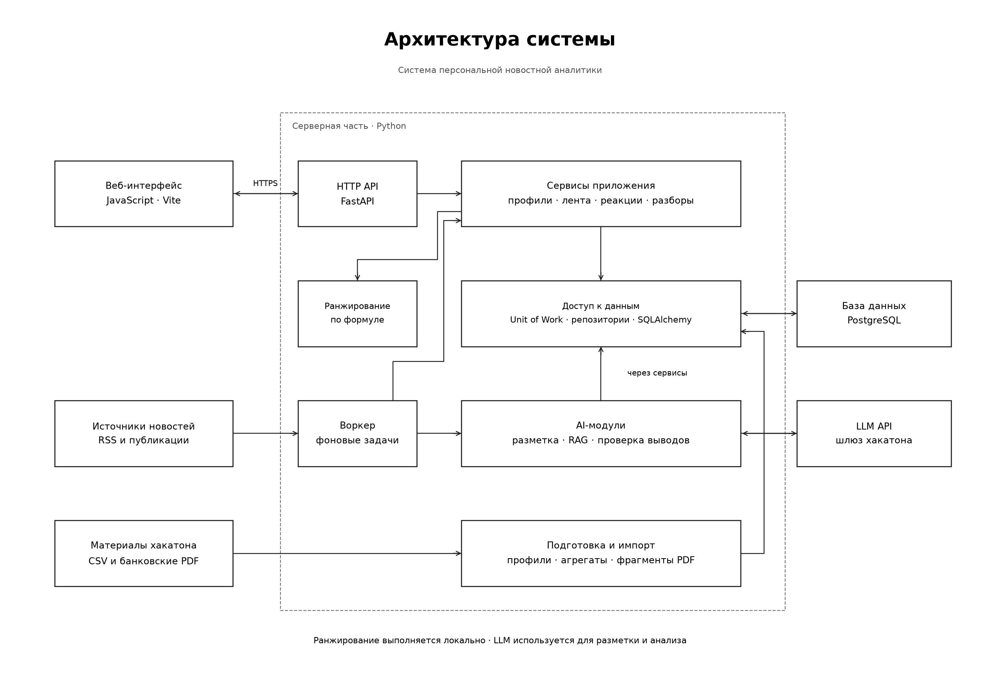

# Backend

Python 3.12 · PostgreSQL 17

- **[Настройка и запуск](docs/run.md)**: окружение, PostgreSQL, 50 компаний из CSV с LLM-разметкой, новости, отчёты, фронт и воркер
- [Сервер в Docker](docs/run.md#сервер-docker-и-отдельный-фронтенд): первый запуск, загрузка данных, HTTPS и размещение фронта отдельно
- [API](docs/api.md): запросы, параметры и ошибки
- [Сервисы](docs/services.md): методы и использование
- [Схемы бэкенда](docs/architecture.md): таблицы, лента, обработка новостей и AI-задания
- [Обзор приложения](../docs/README.md): архитектура и действия пользователя
- [Качество и мониторинг](docs/quality.md): метрики, проверки, контрагенты, поиск PDF и стоимость
- [Парсер источников](app/README_parser.md)
- [Сторонние компоненты](THIRD_PARTY_NOTICES.md)

Код: `app/`, Pydantic-схемы: `app/schemas/`, SQLAlchemy-модели: `app/infrastructure/database/models/`

CSV компаний, список выбранных ID, PDF, результаты импорта и `.env` хранятся локально и исключены из Git

## Как работает

Разбор отделяет факты новости, выводы AI и позицию банка. Утверждения ссылаются на проверяемые отрывки новости, отчёта или сохранённого профиля компании. Источники с неподходящей темой не становятся подтверждённой позицией банка

Доступ к разборам проверяется по компании сессии. Вход демонстрационный, банковскую авторизацию не заменяет. Ключ модели хранится только на сервере; SQL выполняется через параметризованные запросы. Текст источников не получает полномочий на выполнение кода или запись в БД. Вызовы ограничены дневным счётчиком и остатком бюджета, повторные разборы используют кеш с версиями данных и промпта

Проверки и ограничения: [результаты проверки](docs/verification.md)

Публикации одного события: [объединение источников и стоимость](docs/news-events.md)
