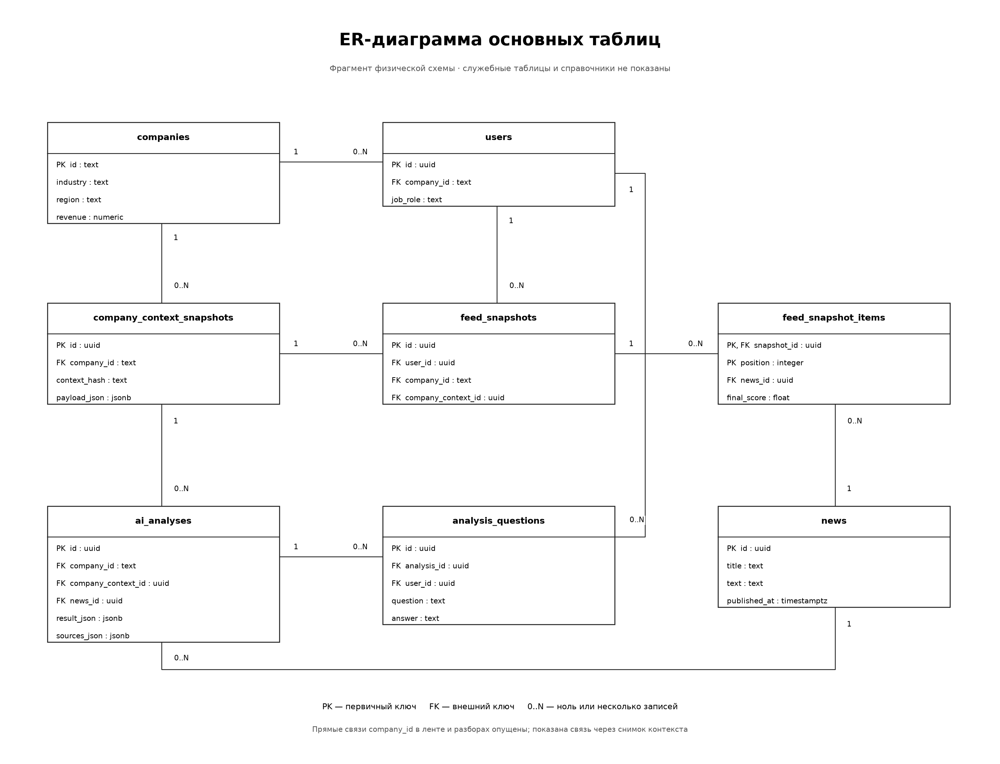
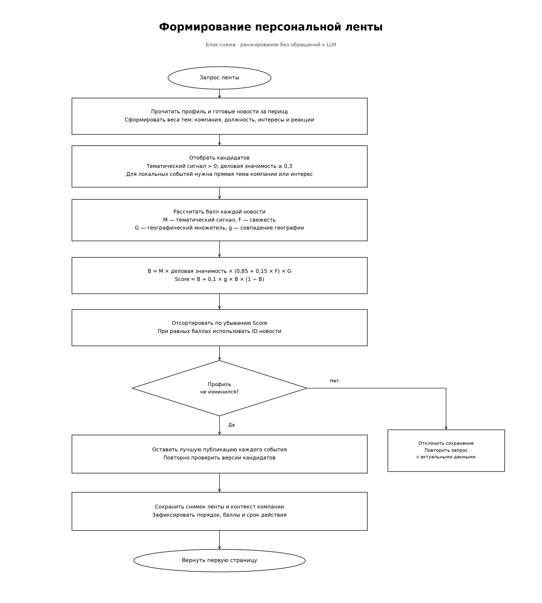
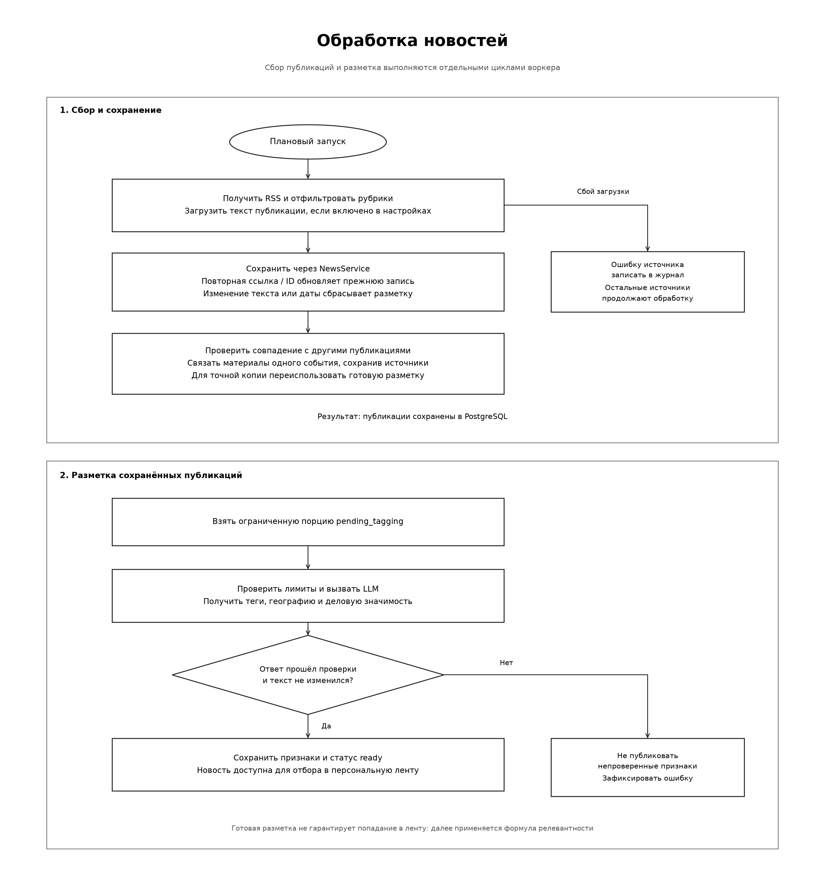
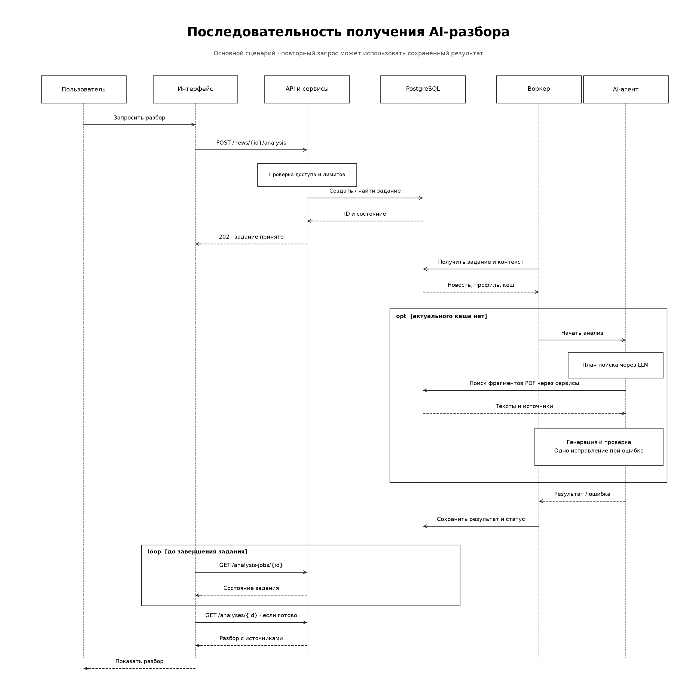
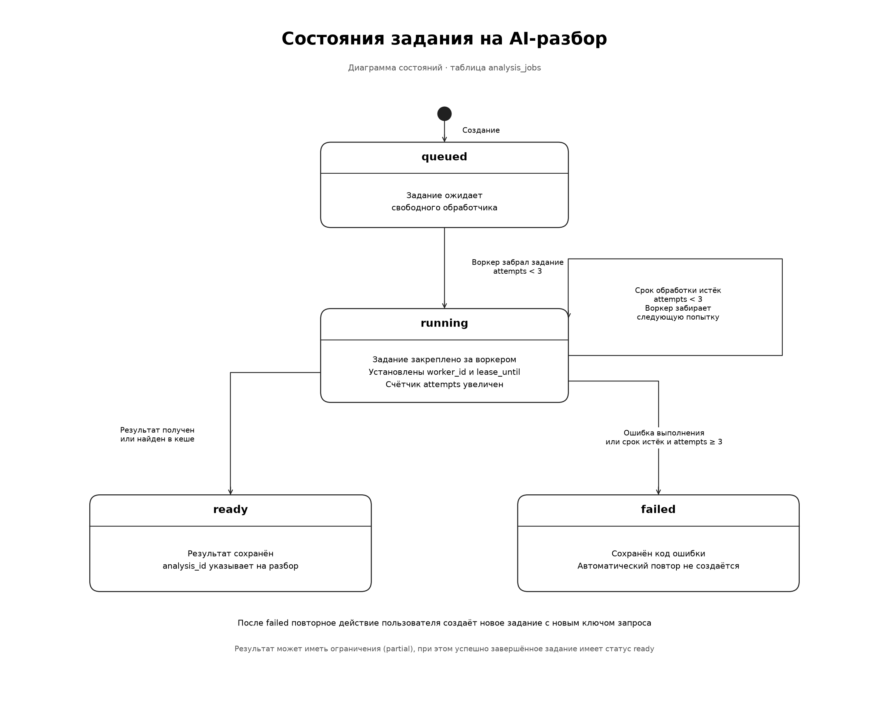

# Схемы бэкенда

Общая структура: [архитектура приложения](../../docs/README.md#архитектура), [действия пользователя](../../docs/README.md#действия-пользователя)

API вызывает сервисы, сервисы используют Unit of Work и репозитории. За пределы сессии возвращаются Pydantic-модели. Методы и параметры: [справочник сервисов](services.md)

## База данных

`PK` обозначает первичный ключ, `FK` — внешний ключ. `1` означает одну запись, `0..N` — от нуля до нескольких связанных записей

Схема показывает основные таблицы и часть связей. `feed_snapshots` фиксирует конкретную выдачу, `feed_snapshot_items` — её порядок и баллы. `company_context_snapshots` сохраняет контекст компании, использованный в ленте или разборе. Изменение текущего профиля не переписывает этот контекст

Полная структура: [SQLAlchemy-модели](../app/infrastructure/database/models). Создание таблиц: [настройка PostgreSQL](run.md#2-postgresql)

## Персональная лента

Ранжирование выполняется между транзакциями. Перед сохранением сервис повторно проверяет профиль и версии кандидатов; при изменении данных снимок не сохраняется. Из публикаций одного события остаётся наиболее подходящая профилю

Методы: [FeedService](services.md#feedservice-персональная-лента). Формула и география: [контекст компании](quality.md#контекст-компании). Объединение источников: [публикации одного события](news-events.md)

## Обработка новостей

Сбор и разметка работают отдельными циклами. Повторная ссылка обновляет существующую публикацию; совпадения между источниками объединяются в событие с сохранением ссылок. Разметка точной копии может использоваться повторно без вызова модели

Методы: [NewsService](services.md#newsservice-новости-и-признаки), [NewsPipeline](services.md#newspipeline-парсер-разметка-и-сохранение). Периодичность и запуск: [воркер](run.md#что-выполняет-воркер)

## AI-разбор

HTTP-запрос создаёт задание и возвращает его ID. Воркер получает новость и контекст компании, проверяет кеш, при необходимости вызывает агента и сохраняет результат. Интерфейс опрашивает состояние задания и загружает готовый разбор

`queued` — ожидание, `running` — обработка, `ready` — результат сохранён, `failed` — ошибка. Истечение срока закрепления позволяет повторно забрать незавершённое задание в пределах лимита попыток. Обычная ошибка выполнения завершает его как `failed`; новая попытка пользователя требует нового ключа запроса

Методы: [InsightService](services.md#insightservice-ai-разборы-и-вопросы). Проверки подтверждений и стоимость: [качество](quality.md)
