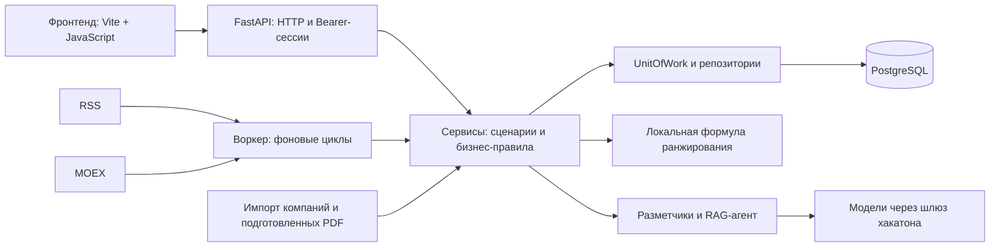
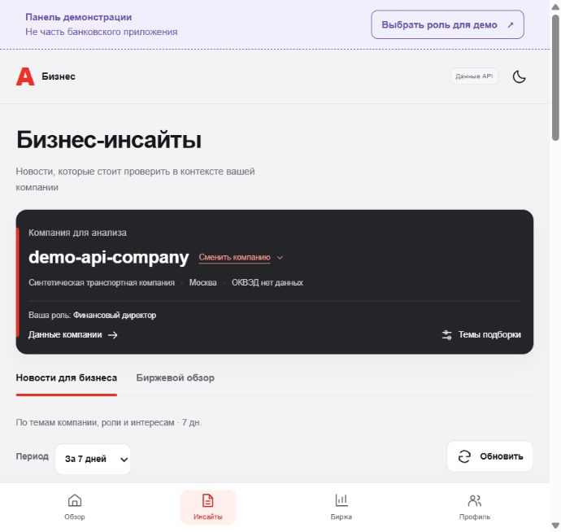
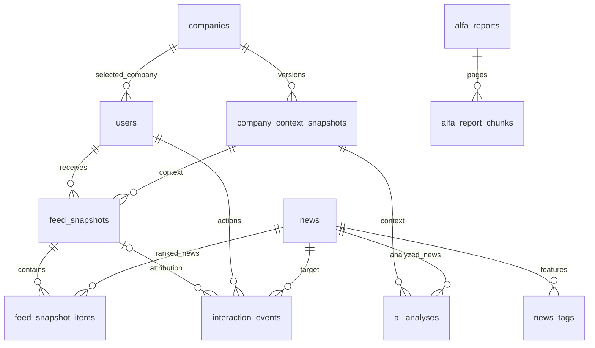
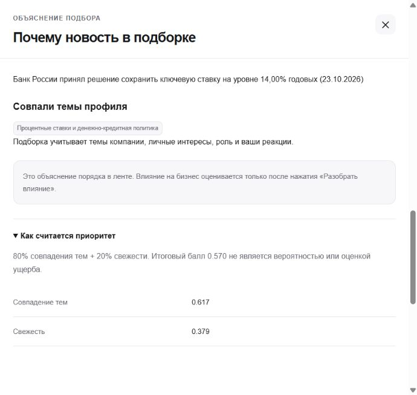
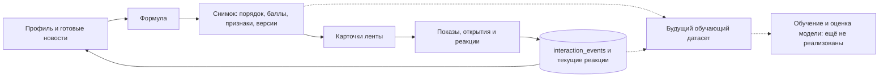
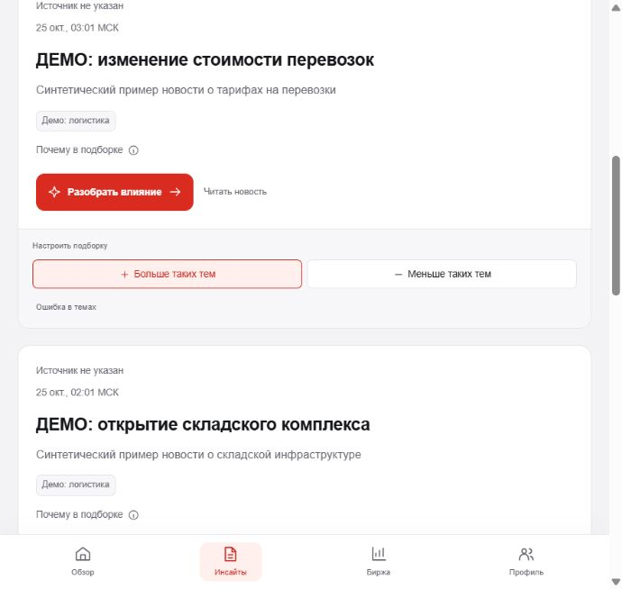
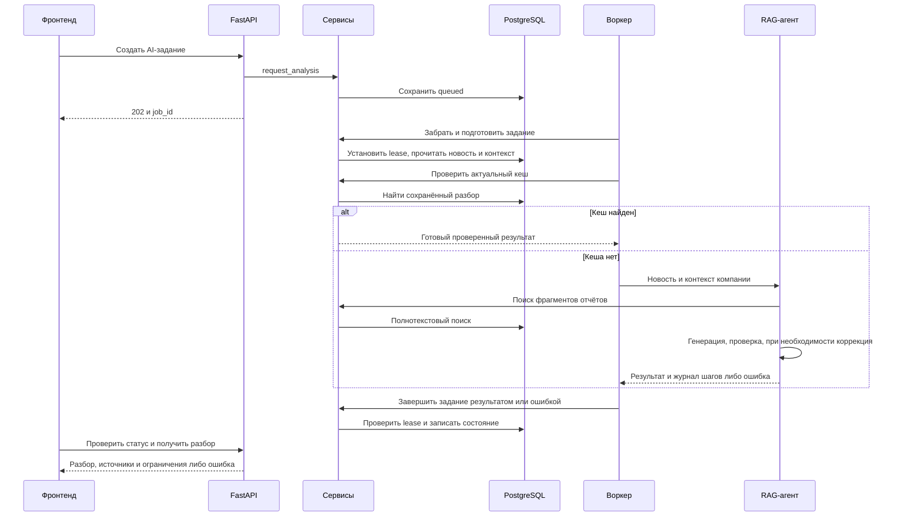
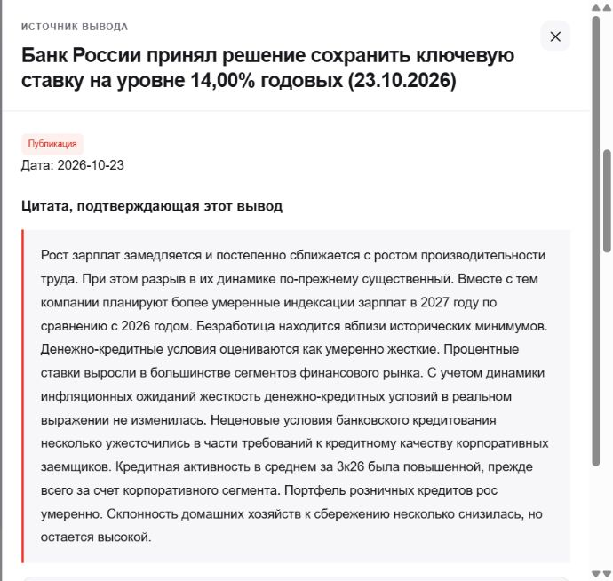

# Технические решения бэкенда

Состояние на 25.10.2026, ветка `dev-dasha_1`. Обзор описывает текущий код; запланированные расширения отмечены отдельно. Скриншоты сняты с фронтенда, подключённого к локальному API: компания `demo-api-company` синтетическая, материал ЦБ загружен из RSS, AI-разбор сохранён в БД.

## 1. Общая архитектура

Бэкенд разделён на HTTP-сервер и отдельный процесс воркера. Они используют одни сервисы и PostgreSQL. Лента рассчитывается локально по формуле; модель вызывается для разметки данных, разбора события и уточняющих вопросов.



Стек: Python 3.12, FastAPI, Pydantic, SQLAlchemy, psycopg, PostgreSQL 17. Redis и отдельного брокера очередей нет: задания AI хранятся в PostgreSQL. База работает в установленном PostgreSQL, файлы её хранилища не лежат в репозитории.

### Границы слоёв

- **`app/api/`**: маршруты, проверка HTTP-параметров, сессия пользователя, коды ошибок
- **`app/services/`**: выбор компании, построение ленты, реакции, задания AI, ограничения и проверка актуальности данных
- **`app/schemas/`**: модели Pydantic для запросов, ответов и обмена между слоями
- **`app/infrastructure/database/repositories/`**: SQL-запросы и преобразование записей в Pydantic-модели
- **`app/infrastructure/database/models/`**: ORM-модели таблиц, связи и ограничения БД
- **`app/services/ai_agents/`**: запросы к модели, схемы результатов и проверка доказательств

API обращается к сервисам. Репозитории работают внутри `UnitOfWork`: связанные изменения фиксируются одним `commit`, при ошибке откатываются. ORM-объекты остаются в слое БД, наружу возвращаются данные, доступные после закрытия сессии. Во время ранжирования и сетевых вызовов модели транзакция не удерживается.

Здесь используются Service Layer, Repository, Unit of Work и DTO. Зависимости передаются параметрами; ранжировщик заменяется как функция с контрактом `RankingRequest → RankingResult`. Примеры: [паттерны](patterns.md), [методы сервисов](services.md).

## 2. Компания, новости и материалы банка

**Компания.** Импорт добавляет выбранную часть или весь набор компаний. `ProfileService` хранит профиль, роль, интересы и выбранную компанию пользователя. `ProfilePipeline` предлагает темы по известным признакам. Регион регистрации хранится отдельно от регионов деятельности и не считается доказательством работы компании в этом регионе.



*Выбранная компания задаёт контекст ленты и AI-разбора. Переключение компании проходит через `PUT /api/profile/company`; роль демосценария вынесена за пределы банковского интерфейса.*

**Новость.** RSS-парсер передаёт запись в `NewsPipeline`, затем `NewsService` сохраняет текст, источник, дату и хэш. `NewsTagger` возвращает темы с уверенностью, географию, тип события, факторы, отрасли и краткое изложение. В ленту попадают только записи со статусом разметки `ready`. Изменение текста или даты сбрасывает разметку. Повтор записи внутри источника не создаёт новую новость; объединение похожих публикаций разных источников пока не подключено.

Для проверки без платной разметки сохранена [подборка из 100 реальных публикаций](news-examples.md). `app/import_news.py` восстанавливает тексты и готовые признаки через `NewsService`; повторная загрузка сохраняет ID. Дополнительные 93 примера размечены ассистентом по источникам, версия `assistant-reviewed-v1` отличает их от автоматической разметки. Они не содержат экспертных оценок релевантности для обучения.

**Материалы банка.** Подготовленные PDF импортируются как отчёты и фрагменты с датой, номером страницы и сведениями о происхождении текста. `ReportService` ищет по русскоязычному полнотекстовому индексу PostgreSQL (`tsvector`, GIN). Векторная БД и эмбеддинги в текущем поиске не используются. Исходный PDF остаётся доступен для сверки цитат.

Основные связи данных:



Это основные связи, не полный перечень таблиц. Ссылки утверждений на источники и цитаты сохраняются в JSON результата AI-разбора; диаграмма не изображает их как внешние ключи.

## 3. Формула рекомендаций

Код: [ranking.py](../app/services/ranking.py), расчёт профиля: [profiles.py](../app/services/profiles.py). Метод `weighted_formula_v1`, версия `formula-v1`. Обученная модель сейчас не используется.

### Итоговый балл новости

$$
S(u,n)=0.8\,M(u,n)+0.2\,F(n)
$$

$$
M(u,n)=\min\left(1,\max\left(\{0\}\cup\left\{\frac{w_{u,t}\,c_{n,t}\,q_{n,t}}{2}:t\in T_n,\;w_{u,t}>0\right\}\right)\right)
$$

$$
A(n)=\max\left(0,\frac{now-published\_at_n}{86400\ \text{секунд}}\right),
\qquad F(n)=\frac{1}{1+A(n)}
$$

- `u` — пользователь, `n` — новость, `T_n` — её тематические теги
- `w` — вес темы в профиле пользователя, от 0 до 2
- `c` — уверенность разметчика в теге, от 0 до 1
- `q` — сохранённый вес качества тега новости, от 0 до 2; по умолчанию 1
- `M` — самое сильное совпадение темы, а не сумма всех совпадений
- `A` — возраст в сутках, включая дробную часть; `F` — свежесть

Если совпадений нет, `M = 0`, но новость может попасть в выдачу по свежести. Отключение темы обнуляет её вклад, а не скрывает все новости с этой темой. Прямых слагаемых для региона, выручки или размера компании в текущей формуле нет; профиль компании влияет через темы.

### Как реакции меняют вес темы

Обозначим `clip(x, a, b) = min(b, max(a, x))`. Базовый вес:

$$
b_{u,t}=\max\left(w^{company}_{t},w^{role}_{u,t},\mathbf{1}_{t\in personal_u}\right)
$$

Отсутствующий вес считается нулём; если для компании есть несколько назначений темы, берётся наибольший вес. Личный выбор даёт теме базовый вес не меньше 1.

$$
r_{u,t}=\operatorname{clip}\left(1+\alpha\left[\ln(1+L_{u,t})-\ln(1+D_{u,t})\right],0,2\right)
$$

$$
w_{u,t}=\begin{cases}
0,&t\in disabled_u\\
\operatorname{clip}(b_{u,t}\,r_{u,t},0,2),&\text{иначе}
\end{cases}
$$

`L` и `D` — количества текущих реакций пользователя «больше / меньше таких тем» на новости с данным тегом. Это не число повторных нажатий. По умолчанию `α = 0.2`; без реакций `r = 1`. Реакции корректируют уже заданные темы и сами по себе не создают положительный вес для отсутствующей темы.

**Пример.** Для финансового директора вес темы ставок равен 1.3. Реакций нет, уверенность тега 0.95, качество 1, новости ровно сутки:

```text
M = 1.3 × 0.95 × 1 / 2 = 0.6175
F = 1 / (1 + 1) = 0.5
S = 0.8 × 0.6175 + 0.2 × 0.5 = 0.594
```

Новости сортируются по убыванию `S`, при равных баллах по строковому ID. Балл не является вероятностью влияния, оценкой ущерба или результатом обучения.



*«Почему в подборке» показывает сохранённые совпавшие темы и компоненты балла. Это отдельный сценарий от AI-разбора влияния на бизнес.*

## 4. Снимок ленты и данные для будущей модели

`FeedService.create_feed()` по умолчанию берёт до 500 последних размеченных новостей за 7 дней. Он читает профиль и кандидатов, закрывает сессию, вызывает ранжировщик, затем проверяет актуальность исходных данных и сохраняет снимок на 30 минут. Следующие страницы читают сохранённый порядок. Реакция меняет следующую подборку, но не переставляет карточки в уже открытой.



**Уже сохраняется:**

- снимок профиля и контекста компании, версия формулы и конфигурации
- позиции новостей, компоненты балла и признаки на момент выдачи: ID тегов, уверенность и вес качества; хэш текста и версия разметки позволяют различать версии новости
- показы с `event_id`, `snapshot_id`, `news_id`, пользователем и временем; фронт отправляет показ при видимости не менее 50% карточки в активной вкладке
- первое открытие текста новости пользователем из конкретного снимка; фоновое чтение через GET открытием не считается
- текущая реакция и история её изменения; одинаковый повтор не меняет счётчики
- замечания к разметке в отдельной таблице `tag_feedback`



*Кнопки «Больше / меньше таких тем» корректируют персональные веса. «Ошибка в темах» сообщает о качестве разметки и не считается личным дизлайком.*

**Минимальный набор для будущей модели:** признаки профиля и новости до показа, позиция и версия выдачи, факт показа, открытие и явная реакция. ID нужны для связи записей и разделения выборок, а не как числовые признаки модели. События ссылаются на снимок и не копируют в себя текст новости, профиль компании или ответ LLM. Поля снимка, нужные интерфейсу и проверке доступа, не нужно целиком включать в обучающую выборку.

На одну новость в одном снимке сохраняется не больше одного показа и одного открытия, даже после перезагрузки страницы. Изменения явной реакции сохраняются отдельно; её снятие не является дизлайком. Отсутствие реакции также не считается отрицательной оценкой. Время чтения, движения мыши, IP и характеристики устройства в сбор для рекомендаций не добавлены.

Новые снимки содержат `ranking_details.training_features` с версией формата и признаком `synthetic`: он устанавливается для синтетической компании или демоисточника. Такие записи нужно исключать при подготовке обучающей выборки. Старые снимки без исторических признаков нельзя дополнять текущими значениями и считать достоверными примерами прошлого.

**Ещё не реализовано:** экспорт обучающей выборки, обучение и сравнение модели с формулой. Неоткрытая новость без подтверждённого показа не является отрицательным примером. При подготовке данных потребуется учитывать позицию в ленте и время наблюдения, чтобы не выдавать предпочтения действующей формулы за независимую оценку релевантности.

## 5. AI-разбор: очередь, RAG и доказательства

`POST /api/news/{news_id}/analysis` создаёт задание и возвращает `202`. HTTP-запрос не ждёт генерацию. Воркер забирает задание через `FOR UPDATE SKIP LOCKED`, устанавливает срок обработки (`lease`) и номер попытки. Повтор запроса с тем же `idempotency_key` возвращает прежнее задание пользователя.



**Работа агента:**

1. Составляет до трёх поисковых запросов с учётом новости и признаков компании
2. Ищет фрагменты банковской аналитики в PostgreSQL; при пустом результате использует резервный поиск по словам заголовка
3. Готовит факты, связь с компанией, риски, возможности, рекомендации и позицию банка
4. Выбирает ID подтверждающих отрывков; сервер подставляет дословные цитаты и проверяет ссылки
5. Отдельным вызовом модели проверяет подтверждённость выводов, даты, условия и связь с компанией; при ошибке допускает одну коррекцию

Для рисков и возможностей обязательно условие. Связь с компанией требует ссылки на фактический признак. Позиция банка требует материала банка с учётом его даты. Если проверка не пройдена, результат не публикуется. При недостающих данных проверенный разбор может иметь `partial` и список ограничений.



*Кнопка источника у утверждения открывает именно его сохранённую цитату. Для PDF доступны страница и оригинал; признаки компании читаются из снимка на момент разбора, а не из её текущего профиля.*

Ключ кеша включает компанию, полную версию новости, хэш контекста и версии модели, промпта, корпуса отчётов, агента и поиска. Срок кеша по умолчанию 24 часа. Перед сохранением повторно проверяются компания, новость и lease, чтобы не записать результат для изменившихся данных.

Уточнения выполняет `QuestionService` в асинхронном HTTP-запросе, без очереди воркера: сохранённый разбор, его источники и последние пять сообщений → ответ → отдельная проверка → сохранение истории. Одновременные уточнения одного пользователя ограничены. Новые события из интернета в этот сценарий не подгружаются.

Код: [AnalysisAgent](../app/services/ai_agents/analysis.py), [InsightService](../app/services/insights.py), [QuestionService](../app/services/questions.py).

## 6. Воркер, стоимость и ошибки

Воркер запускает независимые асинхронные циклы. По умолчанию RSS и котировки обновляются каждые 15 минут, одна pending-новость размечается раз в 5 минут, изменённые профили проверяются раз в 2 минуты, очередь AI раз в 5 секунд. Интервал отсчитывается после завершения операции. Готовые новости и неизменившиеся профили повторно не размечаются. Подготовленные отчёты импортируются при старте.

RSS, котировки, чтение ленты и опрос очереди не вызывают модель. Разметка новости требует одного вызова, новый разбор обычно трёх, с коррекцией до пяти, уточнение двух. В текущих настройках разметка использует `qwen/qwen3.6-35b-a3b`, анализ и профили `z-ai/glm-5.3-flash`; модели задаются через `.env` и проверяются по разрешённому списку.

**Контроль расходов:** общий бюджет шлюза проверяется перед платным вызовом; по умолчанию сохраняется резерв 50 ₽ и действует локальный предел 30 попыток в сутки UTC. Токены и статусы записываются в `llm_usage`. Лимит локальной БД не учитывает другие базы команды, а проверка остатка не резервирует деньги для параллельных запросов.

**Сокращение запросов:** города сгруппированы по регионам без потери кодов и переводов, JSON передаётся компактно, проверяющая модель получает ссылки на уже переданные отрывки вместо повторных копий цитат. На одной и той же новости ЦБ вход разметки сократился с 46 594 до 30 727 токенов, на 34%. Это измерение входных токенов одного примера, не гарантия такой же экономии всей суточной стоимости.

**Устойчивость:**

- синхронные операции БД и парсера выполняются в потоках; сетевые вызовы аналитического агента асинхронные
- таймауты ограничивают подключение, SQL, ожидание блокировок и LLM-запросы
- ошибка одного фонового цикла не останавливает остальные; heartbeat позволяет API обнаружить недоступный воркер
- после аварии задание с истёкшим lease можно забрать снова, максимум три попытки; обычная ошибка обработки даёт `failed`
- при недоступном источнике котировок возвращается последний срез с `stale`, а не выдуманные актуальные данные
- доступ к снимкам и разборам проверяется по пользователю и выбранной компании; HTTP-ошибки не раскрывают SQL, ключи и ответы провайдера

Подробности: [воркер и настройки](worker.md), [HTTP-контракты](api.md).

## 7. Границы текущего решения

Демовход с Bearer-сессией работает, банковская авторизация ещё не подключена. Формула и сбор показов/реакций работают, обученной модели нет. Не подключены платёжные связи и анализ группы компаний, сквозное объединение дублей разных источников и фильтр эмитентов по компании. Нужна отдельная оценка качества на отложенных примерах; технические тесты её не заменяют.

Фронтенд можно собрать для GitHub Pages, но Python API, PostgreSQL и воркер должны работать отдельно. Публичного HTTPS API пока нет. Датасеты, исходные PDF, окружение и ключи не входят в публикуемую сборку.

Дальше по документации: [локальный запуск](run.md) · [настройка PostgreSQL](database-setup.md) · [проверка соответствия и оставшиеся задачи](integration-review.md).
