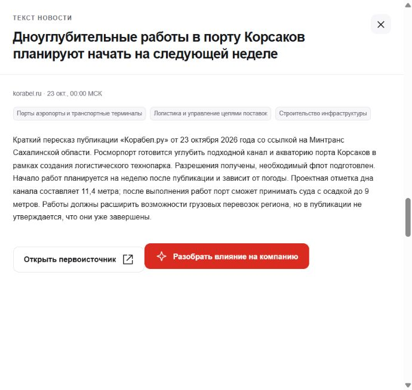

# Реальные новости для проверки

[Подборка JSON](../data/examples/recent-news-2026-10-25.json): 100 публикаций за 19–25 октября 2026 года, 18 источников. События в 24 российских регионах, федеральные и зарубежные новости. Среди тем сельское хозяйство, промышленность, транспорт, IT, энергетика, строительство, торговля, медицина, образование и финансы

В файле сохранены ссылки, даты, краткие пересказы и готовые признаки. Полные статьи и фотографии не копируются

- Первые 7 записей сохраняют разметку модели хакатона; два изложения уточнены после проверки, см. `summary_review`
- Еще 93 записи подготовлены ассистентом без вызовов API модели хакатона: 83 по текстам статей, 10 по сообщениям RSS, когда полная страница недоступна. Основание указано в `review_basis`, способ разметки в `annotation_method=assistant_review`
- Для новых записей теги выбраны из общего справочника. `confidence=1` здесь фиксированный вес включенного тега, а не измеренная вероятность. Это не экспертная разметка
- Регион определяется по событию, не по местонахождению редакции. Федеральные события имеют `nationwide=true`; зарубежные сохраняют код страны без выдуманных российских регионов. География пока не участвует в формуле ранжирования

У первых 7 записей `published_precision=day`: время `00:00+03:00` техническое. У новых `published_precision=rss_timestamp`: дата и время взяты из RSS. Дата публикации может отличаться от даты события; при повторном импорте она не обновляется

## Загрузка в свою БД

1. Настроить БД по [инструкции](database-setup.md) и запустить `app/infrastructure/database/init_db.py`
2. Открыть [app/import_news.py](../app/import_news.py) в PyCharm и выбрать **Run 'import_news'**
3. Запустить API и фронт, выбрать компанию и обновить ленту

Обычный запуск восстанавливает сохранённую разметку без обращения к модели. Повторный импорт не создаёт дубли. Записи без сохранённых признаков остаются `pending` и не входят в ленту

Проверено 25 октября: все 100 записей имеют статус `ready`, доступны через API и вошли в ленту с пагинацией. Повторный импорт сохранил ID и количество записей. При расширении подборки число вызовов модели осталось 29, новых вызовов не было

Параметры конфигурации запуска:

- `--limit 3`: загрузить первые три новости
- `--file путь.json`: использовать другую подборку такого же формата
- `--tag`: разметить записи без признаков через API хакатона и сохранить результат обратно в JSON; расходует лимит LLM

Перед импортом проверяется соответствие сохранённых признаков тексту и дате. Если текст изменён, старые `features`, `content_hash`, `features_published_at` и `tagging_version` нужно убрать и выполнить новую разметку

Это примеры реальных публикаций, а не обучающая выборка. Темы и регионы в метаданных нужны для проверки разнообразия. Оценок релевантности «компания + новость» в подборке нет. Для будущей модели используются реальные показы, открытия и реакции из приложения

Лента по умолчанию охватывает семь дней. Позже эти примеры выйдут из окна: в API можно задать `days` до 365, а для актуальной ленты нужен работающий воркер с источниками
