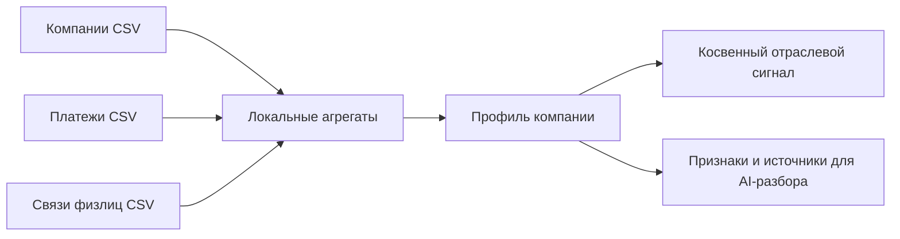

# Качество и контроль обработки

## Проверка после изменений

Из `backend`, с окружением Python 3.12:

```powershell
python app/evaluate.py --database
```

Сохраняются `data/evaluation/<время>.json`, `.md` и `-review.json`. В отчёте: хэш кода, Git revision, версия формулы, хэш контрольных случаев, версия корпуса, модели и промпты проверенных разборов. Данные оценивания исключены из Git

Сравнение с предыдущим отчётом:

```powershell
python app/evaluate.py --database --baseline data/evaluation/ПРЕДЫДУЩИЙ.json
```

Код возврата `1` означает провал порога или ухудшение. Другой набор случаев или корпус отклоняется как несопоставимый. После изменения корпуса сначала проверить новый отчёт и сохранить его как новую базу

### Что измеряется

- **Precision@5**: доля релевантных новостей среди пяти первых позиций
- **nDCG@10**: соответствие порядка выдачи оценкам релевантности 0–3
- **Precision/Recall объединения событий**: ложные объединения и пропущенные пары
- **Recall@5 поиска PDF**: доля запросов, для которых ожидаемый документ найден в пяти фрагментах
- **Отрицательные запросы**: отсутствие результата на контрольных посторонних темах
- **Точность цитат**: цитата действительно содержится в сохранённой выдержке
- **Покрытие ссылками**: у утверждений есть ссылки на существующие источники
- **Полезность**: доля «Разбор помог» среди оценок за 30 дней, вместе с количеством оценок

Фиксированные случаи рекомендаций и дедупликации находятся в `app/evaluation_cases.json`. Это синтетический набор для поиска регрессий. Он не измеряет качество рекомендаций для всех реальных компаний

Поиск проверяется на настоящем корпусе PDF. Цитаты проверяются в последних 100 сохранённых разборах. Пустая выборка обозначается отсутствием оценки

Пороги: Precision@5 ≥ 0,8; nDCG@10 ≥ 0,9; precision и recall объединения контрольных пар = 1; Recall@5 PDF ≥ 0,8; отрицательные запросы, точность имеющихся цитат и покрытие утверждений ссылками = 1. Позиция банка должна ссылаться на банковский материал. При наличии экспертных оценок смысловая подтверждённость должна быть ≥ 0,9

### Смысловая подтверждённость

Совпадение цитаты не доказывает, что из неё следует вывод. Для этой оценки используется `-review.json`:

1. Прочитать результат и источники
2. Для проверенного результата заполнить `supported: true/false`, `reviewer`, `reason`
3. Непроверенные результаты оставить с `supported: null`
4. Запустить:

```powershell
python app/evaluate.py --database --reviews data/evaluation/ПРОВЕРКА-review.json
```

Изменённые результаты и повторные оценки одного ID отклоняются по fingerprint. Без заполненных оценок показатель смысловой подтверждённости остаётся пустым

## Постоянный мониторинг

Воркер обновляет `processing_states.monitoring` каждую минуту и проверяет качество раз в сутки. После изменения кода проверка повторяется на ближайшем часовом проходе; неудачная проверка также повторяется через час. Перезапуск не обнуляет интервал

`processing_states.quality_check` содержит последний результат, `quality_history` хранит последние 30 проверок с хэшами кода, контрольных случаев и корпуса. Сбой оценивания сохраняется как неудачная проверка с типом ошибки. Текущий результат включён в `/api/status` в поле `monitoring.value.quality`

Мониторинг считает длительность p95 и долю ошибок последних 100 выполнений каждой операции, очередь разметки, задания за сутки, сегодняшние попытки LLM, свежесть готовых новостей и оценки полезности. Простой очереди разбора не считается обработанной задачей

Предупреждения: heartbeat старше минуты, новости старше 72 часов, три ошибки операции подряд, провал последней оценки качества, отсутствие проверки или её возраст более 26 часов, исчерпанный лимит запросов или денежный резерв LLM. При изменении предупреждений воркер пишет их в журнал. Возраст новостей считается без синтетического демоисточника

```powershell
python app/monitor.py --check
```

Вывод JSON; при предупреждениях код возврата `1`. Те же агрегаты доступны в `/api/status`. Мониторинг не перезапускает процессы и не исправляет данные автоматически

### Оценка разбора

В конце разбора находятся «Разбор помог» и «Не помог». Это отдельная оценка полезности; интересы пользователя не меняются

`GET /api/analyses/{id}/feedback` возвращает `{ "useful": null | true | false }`

`PUT /api/analyses/{id}/feedback` принимает `{ "useful": true | false }`

Нужна сессия пользователя той же компании. Одна оценка на пользователя и разбор; повторный запрос обновляет её

## Контекст компании



Для входящих и исходящих платежей отдельно сохраняются: число контрагентов, доля крупнейшего, пять основных ОКВЭД и регионов с долями, доля известных профилей и платежей внутри группы. Знаменатель долей включает все валидные платежи направления, в том числе контрагентов без известного профиля

Для группы и связей через физлиц сохраняются количества компаний и наиболее частые отрасли/регионы. Идентификаторы физлиц не сохраняются в профиле и не отправляются модели. Связь через физлицо не доказывает владение. Показатели описывают предоставленную платёжную выборку, а не полный денежный поток компании

Косвенный вес темы `t`:

```text
C(t) = min(0.25, 0.125 × сумма долей входящих и исходящих платежей
                         по ОКВЭД контрагентов, соответствующим t)
```

Основной балл и итог:

```text
W(t) = min(1, вес темы профиля × уверенность тега × качество тега / 2)
D(t) = W(t)                    для темы отрасли или личного интереса
D(t) = 0.7 × W(t)              для остальных тем профиля
I(t) = C(t) × уверенность тега × min(1, качество тега)
M = max(D(t), I(t))            по всем тегам новости
F = 1 / (1 + возраст в днях / 3)
B = M × деловая значимость × (0.85 + 0.15 × F) × G
Score = B + 0.1 × совпадение географии × B × (1 − B)
```

`G = 1` по умолчанию. Для локальной новости из другого региона `G = 0.3` при известных регионах деятельности, `0.6` при известной только регистрации; для другой страны `0.2`. Совпадение географии: `1` для региона деятельности или общенациональной новости своей страны, `0.5` для совпадения регистрации, `0` для несовпадения или отсутствия данных

Доли в формуле находятся в диапазоне 0–1. ОКВЭД сопоставляется с темой по локальному справочнику. `C(t)` сравнивается с основным тематическим баллом через максимум; он не складывается с ним. Затем применяются существующие множители деловой значимости, свежести и географии. Локальное событие по-прежнему требует прямой отраслевой темы или личного интереса. Отключённая тема не получает косвенный вес

Обновление вычисляемых признаков существующих 50 компаний:

```powershell
python app/refresh_company_context.py
```

Разметка компании сохраняется только если вход классификатора не изменился. Новые агрегаты контрагентов используются в анализе и формуле; собственная отрасль компании из них не выводится

## Использование банковских PDF

- В индекс попадают исправленные текстовые блоки или ручная расшифровка страницы
- Непроверенные блоки и таблицы не превращаются в текстовые факты
- Поиск использует последнюю готовую версию каждого файла; прежние фрагменты остаются доступны старым цитатам
- Отчёты с будущей датой исключаются из поиска
- Сначала выбирается лучший фрагмент каждого документа, затем дополнительные: длинный PDF не занимает весь контекст
- Агент сохраняет прежние ограничения: до трёх запросов поиска, по три фрагмента, до десяти источников всего

## Стоимость

Оценка, мониторинг, агрегаты CSV, оценка полезности и улучшенный поиск не вызывают модель. При разборе новые признаки немного увеличивают входной контекст. Число вызовов и общий лимит поисковых фрагментов не увеличены. Старый кеш после изменения контекста и версии поиска не переиспользуется как актуальный разбор

Уточняющий ответ обычно требует генерации и проверки содержания. При ошибке формата, источников или содержания разрешена одна попытка исправления с повторной проверкой. Повторная ошибка завершает запрос без выдачи неподтверждённого ответа. Все попытки учитываются в дневном лимите
