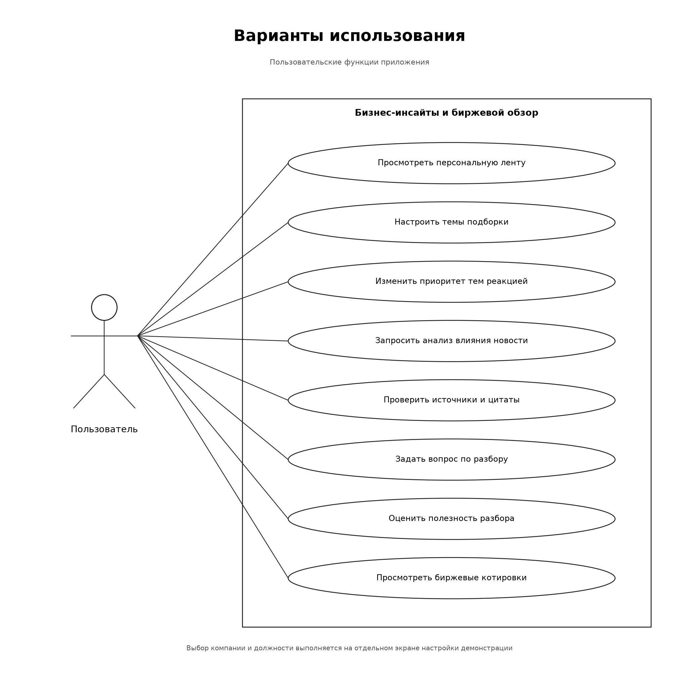

# Устройство приложения

Приложение подбирает новости по компании, должности и интересам пользователя, формирует разбор влияния события с источниками и показывает биржевые котировки

Настройка и запуск: [инструкция](../backend/docs/run.md). Серверные процессы и связи таблиц: [схемы бэкенда](../backend/docs/architecture.md)

## Архитектура

- Фронтенд обращается к HTTP API; ключ LLM остаётся на сервере
- Сервисы проверяют доступ и бизнес-правила, репозитории выполняют запросы к PostgreSQL
- Лента ранжируется локальной формулой без вызова LLM
- Воркер собирает новости, размечает их и обрабатывает задания на AI-разбор
- CSV формируют профили компаний и агрегаты связей; подготовленные банковские PDF используются при поиске подтверждений

Разделение фронтенда и API позволяет размещать их на разных адресах. Параметры подключения и CORS описаны в [инструкции запуска](../backend/docs/run.md#сервер-docker-и-отдельный-фронтенд)

## Действия пользователя

Компания и должность выбираются на отдельном экране настройки входа. Темы подборки меняются над лентой. Реакции корректируют приоритет тем в следующей подборке, а оценка разбора сохраняется отдельно

Запрос разбора создаёт фоновое задание. Интерфейс получает его состояние и показывает результат после завершения. Источники и цитаты доступны вместе с выводами; вопрос по готовому разбору использует его сохранённый контекст

## Подробности реализации

- [База данных и снимки контекста](../backend/docs/architecture.md#база-данных)
- [Формирование ленты](../backend/docs/architecture.md#персональная-лента)
- [Сбор и разметка новостей](../backend/docs/architecture.md#обработка-новостей)
- [Запрос AI-разбора и состояния задания](../backend/docs/architecture.md#ai-разбор)
- [Методы сервисов](../backend/docs/services.md)
- [Дедупликация публикаций](../backend/docs/news-events.md)
- [Формула рекомендаций, качество и контроль стоимости](../backend/docs/quality.md)
